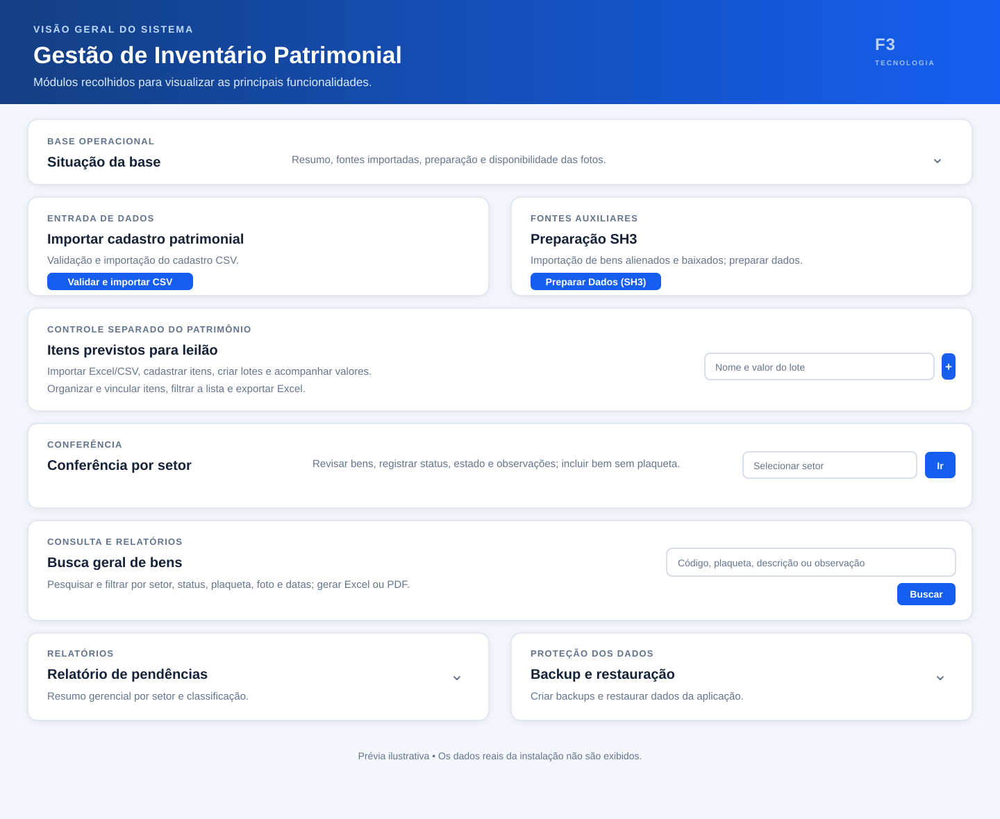

# Gestão Patrimonial

## Prévia da interface



Tecnologias e bibliotecas utilizadas:

- Python
- Flask
- HTML, CSS e JavaScript
- Pandas e OpenPyXL
- Pillow e ReportLab
- MySQL Connector/Python
- Pytest

## Contas e permissões

O armazenamento de contas é separado dos dados patrimoniais e usa SQLite em `PATRIMONIO_WEB_DATA_DIR` (por padrão, `dados_web`). O cadastro patrimonial continua usando o armazenamento já configurado; sem `PATRIMONIO_STORAGE=mysql`, o padrão é Excel.

Na primeira execução, crie a conta administradora pelo terminal local:

```powershell
.\.venv\Scripts\python.exe app.py --criar-admin
```

O usuário e a senha são solicitados no terminal; a senha não aparece enquanto é digitada. Depois, inicie o aplicativo normalmente. A conta administradora pode criar, desativar e redefinir contas de operadores. Senhas temporárias devem ter pelo menos 12 caracteres e são trocadas no primeiro acesso. Não há cadastro público.

Administradores podem gerenciar dados, importações, leilões, usuários e backups. Operadores podem consultar e registrar status, estado, observação e fotos da conferência, mas não podem alterar valores ou descrições, importar, excluir, administrar leilões ou restaurar backups. Relatórios permanecem disponíveis para consulta.

Para usar o cookie de sessão somente em conexões HTTPS, configure antes de iniciar o servidor:

```powershell
$env:PATRIMONIO_WEB_COOKIE_SECURE = '1'
.\.venv\Scripts\python.exe app.py
```

O servidor integrado do Flask é destinado a desenvolvimento local, não a hospedagem pública de produção. Encaminhar uma porta do VS Code não substitui hospedagem, HTTPS nem as demais proteções necessárias para disponibilizar o sistema na internet.
